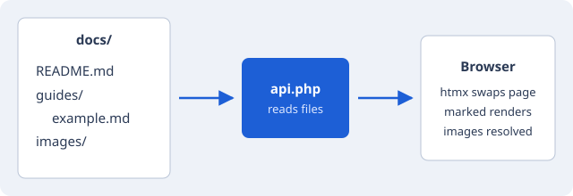

# Welcome

This is a small Markdown viewer. Drop `.md` files and their images into the
`docs/` folder and they show up in the sidebar.



## Images

Write image links the normal way, relative to the Markdown file:

```markdown
        <!-- next to this file -->
     <!-- from a subfolder -->
       <!-- from the docs root -->
 <!-- any web image -->
```

Supported formats: PNG, JPG, GIF, WebP, AVIF, SVG, BMP, ICO.

## Links between documents

Link to other files the same way, and they open here:
see the [example guide](guides/example.md) or jump to its
[table section](guides/example.md#tables).

## Reading settings

At the top of the sidebar (behind the ☰ menu on phones) you can change the
text size, pick a theme (Light, Dark, Sepia, Solarized, Nord, Dracula, Gruvbox and more), and switch on a
dyslexia-friendly font. Your choices are remembered in this browser.

Click or tap any image to open it full screen, then use the arrows or swipe
to move through the rest of the page's images.
