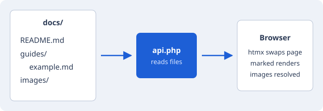

# Example guide

A tour of the formatting the viewer handles. [Back to the welcome page](../README.md).

## Image from a parent folder



## Text

Some **bold**, some *italic*, some ~~struck~~ text, and `inline code`.

> A blockquote, for asides and callouts.

## Lists

1. First
2. Second
   - Nested bullet
   - Another

- [x] Task done
- [ ] Task to do

## Tables

| Setting        | Where        | Default |
|----------------|--------------|---------|
| Docs folder    | `config.php` | `docs/` |
| Site title     | `config.php` | Markdown Viewer |
| Default theme  | `config.php` | auto    |

## Code

```php
<?php
echo "Hello from PHP";
```

---

That's it.
